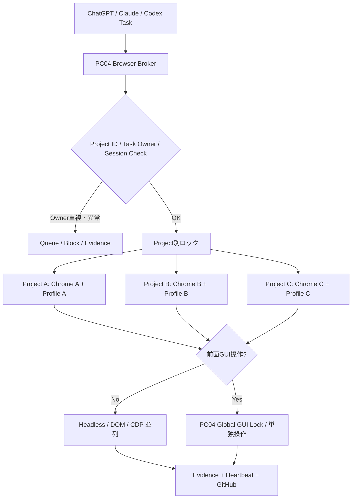

# PC04｜プロジェクト別Chrome分離設計（レビュー案）

作成: 2026-11-19 JST  
状態: **調査・設計のみ。現行プロセス、ログイン、Chrome設定は未変更。**  
対象: PC04(`ks04`)のWeb開発用ブラウザ自動化。PC03/PC04手動切替ルールは変更しない。

## 1. 原因調査：Observed と Hypothesis

### OBSERVED（Windows read-only 診断）

- PC04はOnline。通常（表示あり）のChromeのブラウザ起動元は**1個**、可視トップレベルChromeウィンドウは**12個で全て同じ起動元PID**に属した。複数ウィンドウ≠複数独立ブラウザ。
- ほかに**4個**のPuppeteer系Chromeのブラウザ起動元があり、いずれも `--headless`、異なる一時 `--user-data-dir`、`--remote-debugging-port=0`。画面のフォーカスを直接奪う構成ではない。
- 4個のうち**2個は同じ公開ProjectのNode親プロセス**を持つ。ほか2個のProject ownerは未確定。**4 Projectが独立動作しているとは断定できない**。
- 直近Remote Desktop Commander履歴に、Windows UI Automationで通常Chromeの要素を調査し、ボタンを操作・ウィンドウを前面化する作業が含まれた。複数Taskを排他するowner/GUI lockの存在は確認できない。
- **15秒間の前面ウィンドウ監視では、Chromeの前面PID切替は再現しなかった**。
- Windows Applicationイベントの直近約2時間の対象アプリ障害ログからは、Chrome等のクラッシュを確認できなかった。これで全タスクの成功を証明できるわけではない。
- 別系統のGit push失敗などは履歴にあるが、**Chrome競合がそれらを引き起こした証拠はない**。
- 計測時の物理メモリ使用量は約17.4/31.6GB。メモリ枯渇が主因という証拠はない。

### HYPOTHESIS

共有の通常Chromeに対する前面化、UI Automation、クリック／キーボード入力が異なるTask間で交錯すると、誤対象操作、タイムアウト、やり直しが起きうる。ユーザーの観察した「アクティブ画面が頻繁に変わる」現象とも整合する。ただし衝突時刻の直接ログがないため、**障害の確定原因は未特定**。

## 2. 設計目標

- Project Aのブラウザ操作がProject Bのタブ・認証・ブラウザ状態に影響しない。
- ひとつのProjectがブロック／外部待機中でも、他ProjectのHeadless処理が継続できる。
- Windowsで前面依存GUI操作が必要な場合は、PC04全体で同時に一件だけに制限する。
- 「プロセス稼働」と「開発進捗」をGitHub成果・CI・QA・heartbeatによって区別し、誤った完了宣言を防ぐ。

## 3. 構成

### Brokerの最小インターフェース

- `acquire(project_id, task_id, owner, mode)` — Project IDは許可リストで検証。未登録・owner不一致ならfail-closed。
- `browser(project_id)` — 原則1 Projectに1持続Chrome owner。2番目のTaskは既存ownerを検証して再利用か待機。同じUser Data Directoryを二重使用しない。
- `acquire_gui(project_id, task_id)` — 前面化、SendKeys、座標クリック、ネイティブダイアログ用の**PC04全体排他**。DOM/CDP/HTTPで可能な処理はこのレーンに入れない。
- `heartbeat/status/release` — owner・PID・起動時刻を照合。失敗時に他Project/個人Chromeをkillしない。
- Task記録はGitHub SSOTに対する参照とし、Masterへの動的進捗コピーは作らない。

### Chromeプロファイルと起動

- ローカル領域の例: `%LOCALAPPDATA%\RSS7\BrowserIsolation\<project_id>\profile`。Projectごとに一意で、個人Chromeや既存Chromeのprofileをコピーしない。
- 新規QA／非対話処理は `--headless=new` を優先。CDPを使う場合、Chrome 136以降の要件に合わせ**非既定`--user-data-dir`**を指定。
- `--remote-debugging-port=0`でポートの衝突を避け、接続URLをownerにだけ返す。**127.0.0.1限定、ネットワークへのCDP公開禁止**。Secrets/cookies/DevTools URLは公開Issue・ログへ載せない。
- 対話ログインが必要な業務は、本人承認／既存認証方針を保ったうえで可視Chromeを個別割当。ログイン状態をほかのProjectへ流用しない。
- Chromeプロセス自体を分離しても**Windowsデスクトップの前面フォーカスは共有**なので、GUIレーンの排他は必須。

### エラーと進捗の観測

- 内部記録: project_id, task_id, owner, browser_pid, started_at, profile_id_hash, heartbeat_at, last_git_sha, last_test, last_error_class, state。
- stateは `running / waiting_external / blocked / stalled_suspected / completed`。CPU稼働・新規ウィンドウ数だけを進捗とみなさない。
- heartbeat消失10分などのルールは「疑いの通知」にとどめ、自動再起動・既存Chromeの強制終了を避ける。承認待ち等のTaskは明確に区別。
- 同一Repositoryの変更は一Task一Active Ownerとし、Git push競合はブラウザ分離とは**別に**branch/worktree/PR側で防ぐ。

## 4. 導入手順（既存作業を無停止で温存）

1. **現在**: 読取監査のみ。4つの既存headless Chrome、共有通常Chrome、ユーザーのログイン、セッション、PC03の設定は変更しない。
2. **Phase 1**: Broker/registry/GUI lockの最小実装と単体テストを**別branch**で作成。異なるprofile、重複owner、ログ秘匿、PID誤認を試験。
3. **Phase 2**: 低リスクの**新規**Web QA Taskを1件だけ専用headlessへ移し、独立profile/動的port/QA成功を検証する。
4. **Phase 3**: 新規TaskからProject単位に順次移行。既存タスクの実行中Chromeを強制切替しない。
5. **Phase 4**: 共有通常Chromeを操作するAutomationをGUI全体ロック配下へ移し、前面化競合を抑える。
6. **Phase 5**: 2〜3 Projectの30分並列スモークテスト。Project A停止でもBは継続、Project GUI操作は相互干渉しないことを検証。

## 5. 合格基準・切り戻し

- 2 ProjectのBrowser PID、`user-data-dir`、CDP接続先が一意。利用可能なCDPはlocalhost限定。
- 同一Projectへの2件目Taskは別Chromeの同じprofileを起動せず、再利用またはキューへ入る。
- 片方のheadless QAが停止しても他Projectは継続し、誤フォーカスによるクリック／入力がない。
- GUI操作はGlobal lockにより一件ずつ実行される。
- 認証情報、個人データ、cookie、作業中の未push変更を消さず、ログへ漏らさない。
- 新方式だけを無効化できること。**既存Chrome一括終了／profile削除は切り戻し手順に含めない**。

## 6. 未完了事項とレビューゲート

- 通常Chromeの前面化とTask/Agentを結びつける**時刻付き操作ログ**の長期採取が未実施。現状は「共有GUIが競合点」と確認できたが、固有エラーの因果関係までは未確定。
- 独立headless Browserのうち所有Task未特定の2つについては、既存セッションを壊さずread-onlyで照合する。
- Broker実装、PC04への適用、並列スモークテストは**未実施**。
- 共有アーキテクチャ変更に相当するため、実際のClaude/Gemini独立レビューとコードレビューを経るまで適用・マージしない。擬似レビューを実施済みにしない。
- `ai-master/AGENTS.md`、`DECISIONS.md`、既存のPC03/PC04 Manual Fallback policyを本提案は変更しない。

## 7. 仕様上の根拠

- [Chrome 136 remote debugging: non-standard profile required](https://developer.chrome.com/blog/remote-debugging-port)
- [Playwright: persistent context and user-data-dir exclusivity](https://playwright.dev/docs/api/class-browsertype)
- [Puppeteer launch options](https://pptr.dev/api/puppeteer.launchoptions)

関連：`AGENTS.md`、`CONNECT.md`、`PROJECTS.md`、`docs/operations/PC04_MANUAL_FALLBACK.md`。
